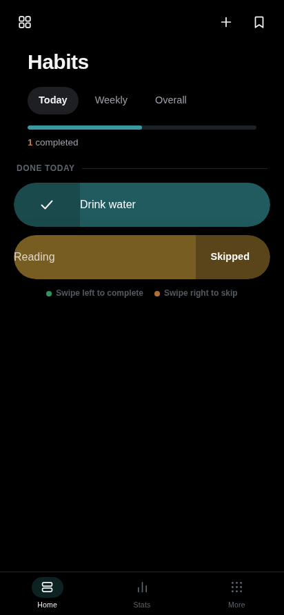
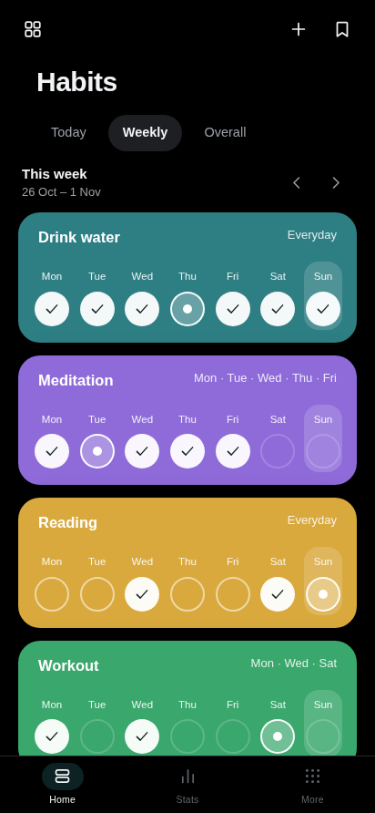
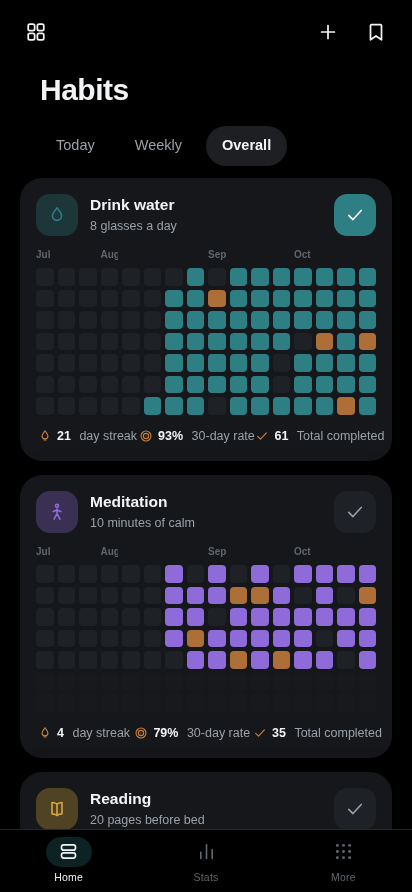
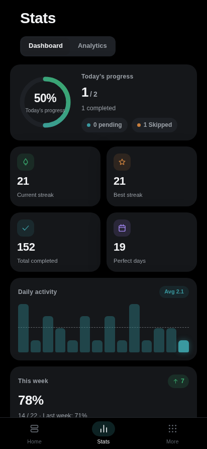
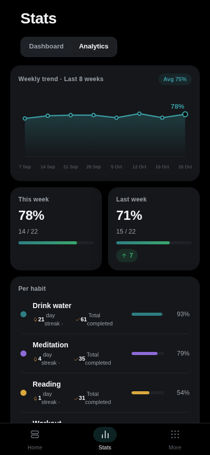
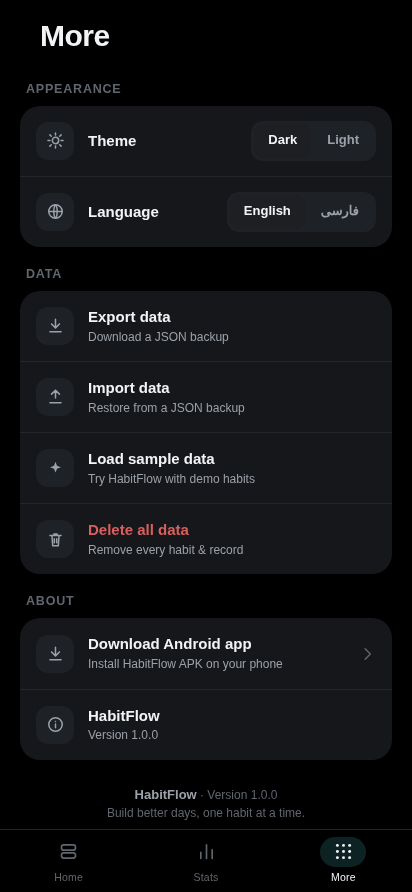

<div align="center">


# HabitFlow

**Build better days, one habit at a time.**

A beautiful, offline-first habit tracker for Android — with directional swipe
actions, streaks, heatmaps and a deep statistics dashboard.

[](https://github.com/realmohamarezaa-netizen/HabitFlow/releases)
[-3DDC84?style=for-the-badge&labelColor=black&logo=android&logoColor=white)](https://www.android.com/)
[](release/HabitFlow-1.0.0.apk)
[](LICENSE)
[](#-privacy--security)

**[⬇ Download the APK](release/HabitFlow-1.0.0.apk)** ·
[Features](#-features) ·
[Screenshots](#-screenshots) ·
[Build](#-build-from-source) ·
[Architecture](#-architecture)

</div>

---

## ✨ Features

| | |
|---|---|
| 🗓 **Three tracking views** | **Today** for the daily list, **Weekly** with per-weekday circles, **Overall** with a GitHub-style contribution heatmap for each habit. |
| 👆 **Directional swipe actions** | Swipe **left** to complete (green check reveal), swipe **right** to skip (orange). Fast, one-handed tracking. |
| 🔥 **Streaks & momentum** | Current streak, best streak, 30-day rate and total completions per habit. |
| 📊 **Deep statistics** | *Dashboard* — progress ring, KPI tiles, daily-activity bar chart, week-over-week %. *Analytics* — 8-week trend line, comparison cards, per-habit completion bars. |
| 🌗 **Dark & Light themes** | Carefully tuned palettes; dark is the default, one tap to switch. |
| 🌍 **Bilingual + RTL** | Full **English** and **فارسی** localization with right-to-left layout mirroring. |
| 💾 **Your data, yours** | Export/import a JSON backup any time; load demo data or wipe everything in one tap. |
| 🛰 **100% offline** | No account, no server, no analytics. Everything lives in on-device storage. |
| 🎯 **Modern adaptive icon** | Teal→emerald gradient, progress ring and check mark — adaptive + legacy variants for all densities. |

## 📱 Screenshots

<div align="center">

| Today | Weekly | Overall |
|:---:|:---:|:---:|
|  |  |  |

| Stats · Dashboard | Stats · Analytics | More (themes · i18n · backup) |
|:---:|:---:|:---:|
|  |  |  |

</div>

## 📲 Install

> **Minimum:** Android 7.0 (API 24) · **Target:** Android 14 (API 34) · **APK ≈ 500 KB**

1. Download the APK: **[release/HabitFlow-1.0.0.apk](release/HabitFlow-1.0.0.apk)**
   (or from [GitHub Releases](https://github.com/realmohamarezaa-netizen/HabitFlow/releases)).
2. Open the file on your phone and allow *Install unknown apps* for your browser/file manager.
3. Install — that's it. No account, no network access needed.

## 🔨 Build from source

No Gradle required — HabitFlow ships a lean, dependency-free build pipeline.

**Prerequisites** (or run [`android/setup-sdk.sh`](android/setup-sdk.sh) once):

- JDK 21 (`javac`)
- Android SDK: `platforms;android-34` + `build-tools;34.0.0`
- Python 3 (standard library only)

```bash
# 1. get the source
git clone https://github.com/realmohamarezaa-netizen/HabitFlow.git
cd HabitFlow

# 2. (optional) point at your SDK if it's not ~/android-sdk
export ANDROID_SDK=/path/to/android-sdk

# 3. build, align, sign & verify
./android/build.sh
```

The signed APK is written to `release/HabitFlow-1.0.0.apk`.
If no keystore is found next to the build script, a new one is generated
automatically — **keep your release keystore private** (it is deliberately
excluded from version control; see [`.gitignore`](.gitignore)).

### Pipeline

```
web/ (HTML/CSS/JS) ──┐
                     ├─► aapt2 compile+link ─► javac ─► d8 ─► pack ─► zipalign ─► apksigner ─► APK
android/res + java ──┘
```

## 🗂 Project structure

```
HabitFlow/
├── web/                     # Hybrid UI source (bundled into assets/www at build time)
│   ├── index.html
│   ├── styles.css           # Design system: tokens, layout, typography
│   ├── ui.css               # Components: cards, sheets, swipe layers, charts
│   └── js/
│       ├── main.js          # App bootstrap & router
│       ├── views.js         # Home / Stats / More renderers
│       ├── store.js         # State, persistence, sample data
│       ├── sheets.js        # Bottom-sheet & dialog engine
│       ├── ui.js            # SVG icon set & DOM helpers
│       └── i18n.js          # EN/FA strings + RTL switch
├── android/
│   ├── AndroidManifest.xml  # minSdk 24 · targetSdk 34 · single exported activity
│   ├── java/…/MainActivity.java   # Hardened WebView shell (back handling, lifecycle)
│   ├── res/                 # Adaptive icons, themes, colors
│   ├── build.sh             # aapt2 → javac → d8 → pack → zipalign → apksigner
│   ├── pack.py              # Repackager (stores resources.arsc uncompressed)
│   ├── setup-sdk.sh         # One-time JDK/SDK installer
│   └── icons/gen_icons.py   # Launcher-icon generator (Pillow)
├── docs/
│   ├── icon.png
│   └── screenshots/         # Play-store style captures
└── release/
    └── HabitFlow-1.0.0.apk  # Latest signed build
```

## 🔒 Privacy & security

- **One permission total** (`VIBRATE` for haptic feedback on completion).
- No `INTERNET` permission — the app physically cannot phone home.
- `allowBackup=false` and `usesCleartextTraffic=false`.
- WebView is hardened: arbitrary `file://` and `content://` access are disabled;
  only the bundled `file:///android_asset` page is ever loaded.
- All habit records live in WebView DOM storage on the device, and can be
  exported/imported as JSON at any time.
- Releases are zipaligned and signed with a 2048-bit RSA key.

## 🗺 Roadmap

- [ ] Widgets & quick tiles
- [ ] Reminders / notifications
- [ ] More locales
- [ ] Material You dynamic color

## 🤝 Contributing

Issues and pull requests are welcome — feel free to open a PR against `main`.

## 📄 License

Released under the [MIT License](LICENSE).

<div align="center">

Made with ♥ by **[realmohamareza](https://github.com/realmohamarezaa-netizen)**

</div>
